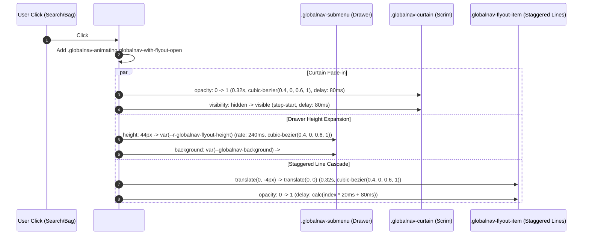

# Apple.com Homepage — Design Specification

- **Source URL**: `https://www.apple.com/`
- **CDP Target IDs**: `80475A27BB8DE29AF8497CAA428DB5EC`, `0B6AD143BAAD5DA9514126C4C36B5963` (`http://127.0.0.1:9222`)
- **Captured Screenshot Viewport**: `1908×1002`
- **Inspected Stylesheets**:
  - `https://www.apple.com/api-www/global-elements/global-header/v1/assets/globalheader.css`
  - `https://www.apple.com/v/homepage/a/styles/main.built.css`
  - `https://www.apple.com/v/homepage/a/styles/homepage.built.css`
  - `https://www.apple.com/v/homepage/a/styles/inline-media.built.css`
  - `https://www.apple.com/homepage/styles/index_3djd5z2w.built.css`
  - `https://www.apple.com/autopush/us/fam-gallery/styles/home-gallery.built.css`
  - `https://www.apple.com/wss/fonts?families=SF+Pro,v3|SF+Pro+Icons,v3`

---

## 1. Layout Geometry

### 1.1 Navbar & Mega Menu Flyout (`#globalnav` — `globalheader.css`, `homepage.built.css`)

| Property / Selector | Desktop (`> 833px`) | Mobile (`<= 833px`) |
| --- | --- | --- |
| `#globalnav` positioning | `position: absolute` (`fixed` in `homepage.built.css`); `top: 0; right: 0; left: 0; z-index: 9999; display: block; margin: 0; width: 100%; min-width: 320px;` | Same |
| `#globalnav` / `--globalnav-height` / `--r-globalnav-height` | `--globalnav-height: 44px; --r-globalnav-height: 44px; height: 48px; max-height: 44px;` | `--globalnav-height: 48px; --r-globalnav-height: 48px; max-height: none;` |
| `.globalnav-placeholder` | `height: 44px;` | `height: 48px;` |
| `.globalnav-content` | `margin: 0 auto; box-sizing: border-box; width: 100%; max-width: 1024px;` | Same |
| `.globalnav-content` inline padding | `padding-inline-start: max(22px, var(--r-globalnav-safe-area-inset-start));`<br>`padding-inline-end: max(22px, var(--r-globalnav-safe-area-inset-end));` | Same |
| `.globalnav-list` | `display: flex; justify-content: space-between; width: auto; height: 44px; margin: 0 -8px; list-style: none;` | — |
| `.globalnav-item` | `box-sizing: border-box; height: 44px;` | — |
| `.globalnav-link` | `padding: 0 calc(8px / var(--r-globalnav-text-zoom-scale, 1)); height: 44px; display: flex; align-items: center; justify-content: center;` | — |
| Backdrop filter | `backdrop-filter: var(--globalnav-backdrop-filter);` (`saturate(180%) blur(20px)`) | Same |

#### Navbar Flyout Dropdown (`#globalnav` — Store, Mac, iPad, iPhone...)

- **DOM Structure**:
  ```html
  <li data-topnav-flyout-item="..." data-topnav-flyout-label="..." class="globalnav-item ...">
    <div data-topnav-flyout class="globalnav-flyout">
      <!-- trigger group + regular trigger button -->
      <div id="globalnav-submenu-..." class="globalnav-submenu">
        <div class="globalnav-submenu-content">
          <div class="globalnav-submenu-group globalnav-submenu-group-elevated">
            <h2 class="globalnav-submenu-header">Explore ...</h2>
            <ul class="globalnav-submenu-list">
              <li class="globalnav-submenu-list-item-elevated"><a class="globalnav-submenu-link">...</a></li>
            </ul>
          </div>
          <div class="globalnav-submenu-group">
            <h2 class="globalnav-submenu-header">Shop ...</h2>
            <ul class="globalnav-submenu-list">
              <li class="globalnav-submenu-list-item"><a class="globalnav-submenu-link">...</a></li>
            </ul>
          </div>
          <div class="globalnav-submenu-group">
            <h2 class="globalnav-submenu-header">More from ...</h2>
            <ul class="globalnav-submenu-list">
              <li class="globalnav-submenu-list-item"><a class="globalnav-submenu-link">...</a></li>
            </ul>
          </div>
        </div>
      </div>
    </div>
  </li>
  ```
- **Opened Flyout Panel (`.globalnav-item-flyout-open .globalnav-submenu`)**:
  - `max-height: calc(100vh - 88px);` (`--r-globalnav-flyout-spacing: 88px`)
  - `.globalnav-submenu-content`: `max-width: 1024px; margin: 0 auto; display: flex; padding-top: 40px; padding-bottom: 84px; padding-inline: max(22px, safe-area-inset);`
- **Page Curtain (`.globalnav-curtain`)**: `position: fixed; inset: 0; z-index: 9998; backdrop-filter: blur(20px);`
- **3-Column Layout (`min-width: 834px`)**:
  - **Column 1 (`.globalnav-submenu-group-elevated` — e.g. `Explore`)**: `max-width: 50%; padding-inline-end: 88px;`. First elevated item `margin-top: 6px;`; secondary items below elevated list `margin-top: 14px;`.
  - **Columns 2 & 3 (`.globalnav-submenu-group` — e.g. `Shop`, `More from...`)**: `max-width: 25%; padding-inline-end: 44px;`.
  - **Links (`.globalnav-submenu-link`)**: `padding: 7px 11px; margin-inline: -11px; margin-bottom: -6px;` (elevated links `padding-top: 9px;`).

### 1.2 Hero Banner Blocks (`section.section.section-hero` — `homepage.built.css`)

- **Section Container (`.section`)**: `display: grid; grid-template-columns: 1fr; gap: 12px;`
- **Hero Content Heights (`--hero-content-height`)**: `580px` default (`692px` at `>=1069px & min-height:776px`; `570px` at `<=1068px`; `650px` at `735-1068px & min-height:734px`; `500px` at `<=734px`).
- **Hero Tiles in `<main>`** (3 full-width hero blocks):
  1. **Holiday 2026** (`data-tile-id="holiday-2026"`, `.theme-dark`, `data-component-list="Holiday2026 InlineMedia"`, `data-holiday-default="pink"`):
     - Headline: `Gifts they’ll love.`
     - Subhead: `Find their perfect match this holiday.`
     - CTA: `Shop gifts` (`/us/shop/goto/store`)
     - **Flex & Padding Layout Preventing Text/Image Overlap**:
       - `.tile-wrapper`: `display: flex; justify-content: center; position: relative; width: 100%; min-height: var(--hero-content-height); box-sizing: border-box; overflow: clip;`
       - `.tile-wrapper` padding: `48px 0 56px` default; `56px 0 63px` (`>=1069px & min-height:776px`); `54px 0 61px` (`<=1068px`); `61px 0 69px` (`735-1068px & min-height:734px`); `39px 0 43px` (`<=734px`).
       - `.tile-content.content-bottom`: `display: flex; flex-direction: column; position: relative; align-items: center; justify-content: flex-end;` — pushes `.tile-copy-wrapper` (`z-index: 2`) and `.tile-ctas` (`margin-top: 17px` / `16px` medium / `11px` small; `z-index: 3`) to the bottom of the hero box, leaving the upper/center area unobstructed for the Apple gift logo graphic in `.tile-image-wrapper`.
       - `.content-bottom + .tile-image-wrapper`: `position: absolute; top: 0; bottom: auto; width: 100%; height: var(--hero-content-height);` with centered `img` (`inset-inline-start: 50%; transform: translate(-50%); bottom: 0; width: auto; height: 100%;`).
  2. **iPhone Duo** (`data-tile-id="iphone-duo"`, light theme):
     - Headline: `iPhone Duo` (font-weight: 600, letter-spacing: -0.015em)
     - Subhead: `Hello, hello.` (split into animated spans `<span class="subhead-word-1">Hello,</span> <span class="subhead-word-2">hello.</span>`, font-weight: 400, letter-spacing: -0.005em, cubic-bezier(0.28, 0.11, 0.32, 1))
     - CTAs: `Learn more` (`/iphone-duo/`), `Buy` (`/us/shop/goto/buy_iphone/iphone_duo`, `.button-secondary`)
  3. **MacBook Pro** (`data-tile-id="macbook-pro-proled-xdr"`, `.tile-macbook-proled.theme-dark`):
     - Headline: `MacBook Pro` (font-weight: 600, letter-spacing: -0.015em)
     - Subhead: `PROLED XDR Display` (gradient text: linear-gradient(90deg, #f5c518 0%, #ffdf6d 22%, #d8efff 42%, #4ea8ff 65%, #0071e3 100%), font-weight: 400, letter-spacing: -0.005em)
     - CTAs: `Learn more` (`/macbook-pro/proled-xdr-display/`), `Buy` (`/us/shop/goto/buy_mac/macbook_pro_proled_xdr`)

### 1.3 Bento Grid / Promo Grid (`section.section.section-promo` — `homepage.built.css`)

- **Grid Structure**: `grid-template-columns: 1fr 1fr; gap: 12px;`, collapsing to `1fr` at `max-width: 734px`.
- **Promo Content Heights (`--promo-content-height`)**: `580px` / `490px` / `500px` (across responsive breakpoints).
- **Promo Tiles in `<main>`** (6 tiles in 2-column Bento grid):
  1. **iPhone 18 Pro** (`data-tile-id="iphone-18-pro"`, `.theme-dark`): `iPhone 18 Pro` / `Pro further.`
  2. **Apple Watch Series 12** (`data-tile-id="apple-watch-series-12"`, `.theme-dark`, `.tile-content-split`): Logo image + `The most accurate heart rate sensing in a wearable.`
  3. **iPad** (`data-tile-id="ipad"`, light theme): `iPad` / `Now with the speed of the A16 chip and double the starting storage.`
  4. **AirPods Pro 3** (`data-tile-id="airpods-pro-3"`, light theme): `AirPods Pro 3` / `The world’s best in-ear Active Noise Cancellation.`
  5. **Apple Upgrade** (`data-tile-id="apple-upgrade"`, light theme): Logo image + `Love it. Lease it. Upgrade it.`
  6. **Apple Card** (`data-tile-id="apple-card"`, light theme): Logo image + `Get up to 3% Daily Cash back with every purchase.`

### 1.4 General 12-Column Grid, Containers & Buttons (`main.built.css`)

- **`.grid`**: `display: grid; grid-template-columns: repeat(12, minmax(0, 1fr)); grid-column-gap: 24px; grid-row-gap: 24px; padding: 24px 24px;` (`--sk-cssgrid-columns: 12`, outer/inner gutter `24px`, bottom outer `0` by default).
- **`.viewport-content`**: `width: 980px;` (`692px` at `max-width: 1068px`, `87.5%` at `max-width: 734px`).
- **`.responsive-content`**: `max-width: 1680px; width: 87.5%;` (`max-width: 420px` at `max-width: 734px`).
- **Buttons**:
  - `.button`: `border-radius: 980px; padding: 9px 16px; border-width: 1px;` (`--sk-button-padding-vertical: 9px; --sk-button-padding-horizontal: 16px;`).
  - `.button-elevated`: `padding: 12px 22px;`
  - `.button-super`: `padding: 18px 31px;`

### 1.5 Endless Entertainment Gallery (`section.section-endless-entertainment-gallery` — `index_3djd5z2w.built.css`, `home-gallery.built.css`)

- **Section Wrapper (`.endless-entertainment`)**: `background-color: #f5f5f7; padding-top: 53px;` (`padding-top: 36px;` at `max-width: 1068px`). `#tv-media-gallery + #fam-media-gallery` has `padding-top: var(--media-gallery-tile-gap)` (`13px`).

#### 1.5A Apple TV+ Main Carousel (`#tv-media-gallery.media-gallery.tv-media-gallery`)

- **Container & Track**:
  - `.media-gallery`: `display: flex; flex-direction: column; align-items: center; position: relative;`
  - `.media-gallery-item-container`: `position: relative; width: calc(var(--media-gallery-tile-width) + var(--media-gallery-tile-gap)); height: var(--media-gallery-tile-height); margin: 0;`
  - `.media-gallery-item`: `position: absolute; width: calc(var(--media-gallery-tile-width) + var(--media-gallery-tile-gap)); height: 100%; display: flex; justify-content: center; background-color: unset; transform-style: preserve-3d; will-change: transform;` (`--media-gallery-slide-duration: 800ms`, `--media-gallery-bottom-copy-duration: 600ms`).
  - `.media-gallery-wrapper-link`: `display: grid; position: relative; width: var(--media-gallery-tile-width); height: 100%; overflow: hidden; background-color: #000; text-decoration: none !important; z-index: 4; backface-visibility: hidden; transform: translateZ(0);` (`pointer-events: none` on inactive slides, `pointer-events: all` on `.current-item .media-gallery-wrapper-link`).
- **Slide Dimensions & Side-Slide Exposure** (`--media-gallery-tile-gap: 13px` across all breakpoints):
  - `>= 1441px`: `1250px × 668px`
  - `1069px – 1440px`: `930px × 523px` (at `1440px` viewport, center `930px` + `13px` gap leaves `(1440 - 930)/2 - 13 = 242px` of each adjacent side slide exposed on left and right)
  - `<= 1068px`: `688px × 367px`
  - `<= 734px`: `275px × 496px`
- **Inactive vs. Active Bottom Copy**: `.media-gallery-bottom-content` `opacity: .36; transition: opacity .4s ease;` (`.current-item .media-gallery-bottom-content`: `opacity: 1;`).
- **Bottom Content Padding**:
  - `>= 1441px`: `padding-left: 70px; padding-bottom: 58px; padding-right: 70px;`
  - `1069px – 1440px`: `padding-left: 48px; padding-bottom: 40px; padding-right: 48px;`
  - `<= 1068px`: `padding-left: 43px; padding-bottom: 34px; padding-right: 43px;`
  - `<= 734px`: `padding-left: 15px; padding-bottom: 30px; padding-right: 15px; flex-direction: column-reverse; text-align: center;`
- **`"Stream now"` Button (`.button.button-neutral.media-gallery-button`)**:
  - `border-radius: 980px; flex-shrink: 0; margin-top: var(--media-gallery-button-margin-top);` (`0` desktop/medium, `13px` at `<= 734px`).
  - `@media(min-width: 1069px)`: `--sk-button-padding-horizontal: 22px; --sk-button-padding-vertical: 12px; --sk-button-min-width-basis: 70px;`.
- **Pagination Dots Bar & Bottom-Right Pause/Play Button**:
  - `.media-gallery-dotnav.dotnav.dotnav-scrim-solid.dotnav-timed`: `margin-top: var(--media-gallery-dotnav-gap); margin-bottom: var(--media-gallery-dotnav-gap);` (`12px` default, `10px` at `<= 734px`); `width: 100%; height: 24px;` (`--sk-dotnav-iconcontrol-icon-size: 24px`); `position: relative; display: flex; align-items: center; justify-content: center; flex-direction: row-reverse; order: 4;`.
  - `.dotnav.dotnav-scrim-solid .dotnav-items`: `border-radius: 999px;`, dots `--sk-dotnav-size: 8px; --sk-dotnav-margin-block: 8px; --sk-dotnav-margin-inline: 8px;` (`--sk-dotnav-timed-track-width: 32px; --sk-dotnav-timed-duration: 3000ms;`).
  - `.media-gallery-dotnav-iconcontrol.dotnav-iconcontrol`: `position: absolute; top: unset; right: calc(12px + env(safe-area-inset-right));` (`10px` at `<= 734px`), `width: 24px; height: 24px; border-radius: 50%; padding: 0;`.

#### 1.5B Services Gallery (`#fam-media-gallery.media-gallery.fam-media-gallery`, `data-gallery-wrap-by="3"`)

- **Card Dimensions & Gap** (`--media-gallery-tile-gap: 13px`):
  - `>= 1441px`: `470px × 264px` (`~16:9`)
  - `1069px – 1440px`: `417px × 234px` (`~16:9`)
  - `<= 1068px`: `188px × 254px` (portrait card)
- **Bottom Content Padding**:
  - `>= 1069px`: `padding-left: 19px; padding-bottom: 15px; padding-right: 15px;`
  - `<= 1068px`: `padding-left: 20px; padding-right: 20px;` (`30px` at `<= 734px`)
- **Service Logo Positions & Sizes (`.fam-media-gallery .media-gallery-top-content`)**:
  - Desktop (`>= 1069px`): `display: flex; flex-direction: row-reverse; width: 100%; position: absolute; top: 0; padding-block-start: 15px; padding-inline-end: 15px; box-sizing: border-box;` (top-right corner).
  - `<= 1068px`: `padding-block-start: 0; padding-inline-end: 0; justify-content: center; margin-top: 13px;` (top-center).
  - SVG dimensions: `.media-gallery-logo-fitness` (`78×21px`, `88×20px` at `<= 1068px`), `.media-gallery-logo-arcade` (`68×21px`, `72×20px` at `<= 1068px`), `.media-gallery-logo-music` (`59×21px`, `64×20px` at `<= 1068px`).
- **Title Positions, Music Card Layout & Button Specs**:
  - `.fam-media-gallery .media-gallery-bottom-content`: `>= 1069px`: `justify-content: space-between; flex-flow: row-reverse;` (button on right, title on left); `<= 1068px`: `justify-content: center; flex-flow: column-reverse;` (title centered above button; `width: 100%; text-align: center; margin-left: 0; margin-bottom: 8px;`).
  - **Music Cards (`.media-gallery-bg-wrapper-music`)**: `display: flex; align-items: center;` (`flex-direction: column;` at `<= 1068px`). `.media-gallery-bg.media-gallery-bg-music`: square album art (`226×226` / `196×196` / `122×122`), `margin-left: 19px; border-radius: 8px; box-shadow: 3px 5px 30px rgba(0, 0, 0, .22); flex-shrink: 0;` (`margin-left: 0; margin-top: 46px;` at `<= 1068px`). Title `.media-gallery-longnote-music`: beside album art on desktop (`margin-left: 19px`), or moved to bottom-content on `<= 1068px`.
  - **Button (`.fam-media-gallery .media-gallery-button`)**: Labels `"Play now"` (Arcade), `"Listen now"` (Music), `"Watch now"` (Fitness+). Desktop (`>= 1069px`): `padding: 9px 16px`, `--sk-button-border-width: 1px`, `min-width-basis: 60px`, `border-radius: 980px`. `<= 1068px`: `--sk-button-padding-horizontal: 11px; --sk-button-padding-vertical: 4px; --sk-button-min-width-basis: 45px;`.

---

## 2. Color Palette

### 2.1 Theme Tokens (`main.built.css`)

| Token | `.theme-light` (default) | `.theme-dark` |
| --- | --- | --- |
| `--sk-body-background-color` | `rgb(255, 255, 255)` (`#ffffff`) | `rgb(0, 0, 0)` (`#000000`) |
| `--sk-body-text-color` | `rgb(29, 29, 31)` (`#1d1d1f`) | `rgb(245, 245, 247)` (`#f5f5f7`) |
| `--sk-headline-text-color` | `rgb(29, 29, 31)` (`#1d1d1f`) | `rgb(245, 245, 247)` (`#f5f5f7`) |
| `--sk-body-link-color` | `rgb(0, 102, 204)` (`#0066cc`) | `rgb(41, 151, 255)` (`#2997ff`) |
| `--sk-fill` | `rgb(255, 255, 255)` | `rgb(0, 0, 0)` |
| `--sk-fill-secondary` | `rgb(250, 250, 252)` | `rgb(22, 22, 23)` |
| `--sk-fill-tertiary` | `rgb(245, 245, 247)` (`#f5f5f7`) | `rgb(29, 29, 31)` |
| `--sk-fill-gray` | `rgb(29, 29, 31)` | — |
| `--sk-fill-gray-secondary` | `rgb(134, 134, 139)` (`#86868b`) | `rgb(110, 110, 115)` |
| `--sk-fill-gray-tertiary` | `rgb(210, 210, 215)` | `rgb(66, 66, 69)` |
| `--sk-fill-gray-quaternary` | `rgb(232, 232, 237)` | `rgb(51, 51, 54)` |
| `--sk-fill-blue` | `rgb(0, 113, 227)` (`#0071e3`) | — |
| `--sk-tile-background` | `rgb(255, 255, 255)` | `rgb(0, 0, 0)` |

### 2.2 Navbar & Mega Menu Colors (`globalheader.css`)

| Token / Element | Light (default) | Dark (`.globalnav-dark` / `.theme-dark #globalnav`) |
| --- | --- | --- |
| `--r-globalnav-color` | `rgba(0, 0, 0, .8)` | `rgba(255, 255, 255, .8)` |
| `--r-globalnav-color-secondary` | `#333336` | `#E8E8ED` |
| `--r-globalnav-color-hover` | `#000000` | `#FFFFFF` |
| `--r-globalnav-background-opened` / `-dark` | `#fafafc` | `#161617` |
| `--r-globalnav-submenu-header-color` | `rgb(110, 110, 115)` (`#6e6e73`) | `rgb(134, 134, 139)` (`#86868b`) |
| `--globalnav-background` | `rgba(250, 250, 252, .8)` (fallback `.92`) | `rgba(22, 22, 23, .8)` (fallback `.88`) |
| `.globalnav-curtain` | `rgba(232, 232, 237, .4)` + `backdrop-filter: blur(20px)` | `rgba(0, 0, 0, .4)` + `backdrop-filter: blur(20px)` |

### 2.3 Tiles, Holiday Banner, Buttons, Controls & Gallery Colors

- **Tiles (`homepage.built.css`, `index_3djd5z2w.built.css`)**:
  - `.tile-wrapper`: `#f5f5f7` (light) / `#000` (dark)
  - `.theme-dark` text / secondary: `#f5f5f7` / `#86868b`
  - `.tile-callout`: `#6e6e73`
  - `.endless-entertainment`: background `#f5f5f7`
- **Holiday 2026 Banner (`[data-tile-id="holiday-2026"]`)**:
  - Text color (`.theme-dark .tile-copy-wrapper`): `#f5f5f7`
  - `--holiday-background` theme variants: `pink`: `#5A122C`, `blue`: `#00224D`, `green`: `#1A4C44`, `yellow`: `#822704`
- **Buttons (`main.built.css`, `home-gallery.built.css`)**:
  - Primary `.button`: background `rgb(0, 113, 227)`, hover `#0076DF`, active `#006EDB`, text `rgb(255, 255, 255)`, focus outline `2px solid #0071e3`.
  - `.button-secondary`: background `transparent`, text `rgb(0, 102, 204)` (dark: `rgb(41, 151, 255)`), border `rgb(0, 102, 204)` (dark: `rgb(41, 151, 255)`), hover background `#0076DF`, active background `#006EDB`, hover text `rgb(255, 255, 255)`.
  - `.button-neutral`:
    - Light: background `rgb(29, 29, 31)`, hover `#272729`, active `#18181A`, text `#fff`.
    - Dark / Gallery CTAs (`.theme-dark .tv-media-gallery .media-gallery-button`, `.fam-media-gallery .theme-dark .media-gallery-button`): `--sk-button-color: rgb(0, 0, 0); --sk-button-background: rgb(245, 245, 247);` (hover `rgb(255, 255, 255)`, active `#EDEDF2`).
- **Inline Media Controls (`inline-media.built.css`)**:
  - Play/pause button colors: `#d2d2d7a3`, `#424245b8`, `#0000008f`.
- **Gallery Overlays, Gradients, Scrims & Dotnav (`home-gallery.built.css`)**:
  - `.media-gallery-headline`: `#000` (`.theme-dark`: `#fff`).
  - `.tv-media-gallery .media-gallery-contents`:
    - Desktop/Medium: `background: radial-gradient(100% 33% at left bottom, rgba(0, 0, 0, 0.5) 0%, rgba(255, 255, 255, 0))`
    - Small (`<= 734px`): `background: linear-gradient(rgba(0, 0, 0, 0) 50%, rgba(0, 0, 0, 0.7)), linear-gradient(180deg, rgba(0, 0, 0, 0.4) 0%, rgba(255, 255, 255, 0) 200px)`
  - `.fam-media-gallery .theme-dark .media-gallery-contents`:
    - `>= 1069px`: `linear-gradient(to bottom, rgba(29, 29, 31, 0.4) 0%, rgba(29, 29, 31, 0) 70px, rgba(29, 29, 31, 0) calc(100% - 70px), rgba(29, 29, 31, 0.4) 100%)`
    - `<= 1068px`: `linear-gradient(to bottom, rgba(29, 29, 31, 0.45) 0%, rgba(29, 29, 31, 0) 60px, rgba(29, 29, 31, 0) calc(100% - 120px), rgba(29, 29, 31, 0.45) 100%)`
    - `<= 734px`: `linear-gradient(rgba(0, 0, 0, 0) 50%, rgba(0, 0, 0, 0.7)), linear-gradient(180deg, rgba(0, 0, 0, 0.4) 0%, rgba(255, 255, 255, 0) 200px)`
  - `.media-gallery-longnote`: `color: #f5f5f7; text-shadow: 0px 0px 5px rgba(0,0,0,.6);`
  - `.dotnav.dotnav-scrim-solid .dotnav-items`: `background: rgb(232, 232, 237);`; dots: inactive `rgba(0, 0, 0, 0.48)`, hover `rgba(0, 0, 0, 0.72)`, current `rgb(0, 0, 0)`.
  - `.media-gallery-dotnav-iconcontrol`: `background: rgba(210, 210, 215, 0.64)` (hover `rgba(223, 223, 227, 0.6976)`), `color: rgba(0, 0, 0, 0.48)` (hover `rgba(0, 0, 0, 0.72)`).
  - `.media-gallery-logo`: `fill: #fff;` (`.theme-light .media-gallery-logo-music > svg { fill: #1d1d1f; }`).
- **FAM Gallery Item Backgrounds (`#fam-media-gallery` items 1–9)**:
  1. Hello Kitty Island Adventure (Arcade): `#f4f8fb`
  2. Miley: The Zane Lowe Interview (Music): `#000000`
  3. Join the Team with "Ted Lasso" (Fitness+): `#24568e`
  4. PowerWash Simulator (Arcade): `#9fc6f4`
  5. New Music Daily (Music): `#300402`
  6. Meditation with Christian (Fitness+): `#241004`
  7. Madden NFL 27 Arcade Edition (Arcade): `#1f0f0f`
  8. Today's Hits (Music): `#c69851`
  9. Programs (Fitness+): `#524617`

---

## 3. Typography

### 3.1 Webfonts (`/wss/fonts?families=SF+Pro,v3|SF+Pro+Icons,v3`)

- `@font-face` declarations for `SF Pro Display`, `SF Pro Text`, and `SF Pro Icons` (weights `100`–`900`, `normal` and `italic`, formats `woff2`, `woff`, `ttf`).

### 3.2 Navbar & Mega Menu (`globalheader.css`)

| Selector / Breakpoint | Font Family | Font Size | Line Height | Font Weight | Letter Spacing |
| --- | --- | --- | --- | --- | --- |
| `.globalnav-link` (Desktop) | `SF Pro Text, SF Pro Icons, Helvetica Neue, Helvetica, Arial, sans-serif` | `12px` | `1` | `400` | `-.01em` |
| `.globalnav-link` (Mobile Menu `<= 833px`) | `SF Pro Display, ...` | `28px` | `1.1428571429` | `600` | `.007em` |
| `.globalnav-link-apple` | — | `17px` (`19px` at `<= 833px`) | `1.2353641176` | `600` | `-.022em` |
| `.globalnav-submenu-header` (`>= 834px`) | `SF Pro Text, ...` | `12px` | `1.3333733333` | `400` | `-0.01em` |
| `.globalnav-submenu-list-item-elevated` (Col 1 `Explore`, `>= 834px`) | `SF Pro Display, SF Pro Icons, Helvetica Neue, Helvetica, Arial, sans-serif` | `24px` | `1.1666666667` | `600` | `.009em` |
| `.globalnav-submenu-list-item` (Cols 2–3 `Shop` / `More from...`, `>= 834px`) | `SF Pro Text, SF Pro Icons, Helvetica Neue, Helvetica, Arial, sans-serif` | `12px` | `1.3333733333` | `600` | `-0.01em` |

### 3.3 Headlines, Subheads, Body, CTAs & Galleries (`main.built.css`, `homepage.built.css`, `home-gallery.built.css`)

| Component / Selector | Breakpoint | Font Family | Font Size | Line Height | Font Weight | Letter Spacing |
| --- | --- | --- | --- | --- | --- | --- |
| `.typography-tile-headline` (Hero titles) | Desktop | `SF Pro Display, ...` | `56px` | `1.0714285714` | `600` | `-.005em` |
| `.typography-tile-headline` | `<= 1068px` | `SF Pro Display, ...` | `48px` | `1.0834933333` | `600` | `-.002em` |
| `.typography-tile-headline` | `<= 734px` | `SF Pro Display, ...` | `32px` | `1.125` | `600` | `.002em` |
| `.typography-tile-subhead` (Hero subtitles) | Desktop | `SF Pro Display, ...` | `28px` | `1.1428571429` | `400` | `.007em` |
| `.typography-tile-subhead` | `<= 1068px` | `SF Pro Display, ...` | `24px` | `1.1666666667` | `400` | `.009em` |
| `.typography-tile-subhead` | `<= 734px` | `SF Pro Display, ...` | `19px` | `1.2105263158` | `400` | `.012em` |
| `.typography-headline` | Desktop | `SF Pro Display, ...` | `48px` | `1.0834933333` | `600` | `-.002em` |
| `.typography-headline` | `<= 1068px` | `SF Pro Display, ...` | `40px` | `1.1` | `600` | `0em` |
| `.typography-headline` | `<= 734px` | `SF Pro Display, ...` | `32px` | `1.125` | `600` | `.002em` |
| `.typography-promo-headline` / `.section-promo .tile-headline` (Bento titles) | Desktop | `SF Pro Display, ...` | `40px` | `1.1` | `600` | `0em` |
| `.typography-promo-headline` / `.section-promo .tile-headline` | `<= 1068px` | `SF Pro Display, ...` | `32px` | `1.125` | `600` | `.002em` |
| `.typography-promo-subhead` / `.section-promo .tile-subhead` (Bento subtitles) | Desktop | `SF Pro Display, ...` | `21px` | `1.1904761905` | `400` | `.011em` |
| `.typography-promo-subhead` / `.section-promo .tile-subhead` | `<= 1068px` | `SF Pro Display, ...` | `19px` | `1.2105263158` | `400` | `.012em` |
| `.tile-callout` | All | — | `14px` | — | — | — |
| `.typography-body-reduced` | All | `SF Pro Text, ...` | `14px` | `1.4285914286` | `400` | `-.016em` |
| `.typography-caption` | All | `SF Pro Text, ...` | `12px` | `1.3333733333` | `400` | `-.01em` |
| `.button` (CTAs / Buttons) | All | `SF Pro Text, SF Pro Icons, Helvetica Neue, Helvetica, Arial, sans-serif` | `14px` | `1.2857742857` | `400` | `-.016em` |
| `.button-elevated`, `.button-super`, `.tv-media-gallery .media-gallery-button` (`>= 1069px`) | All / `>= 1069px` | `SF Pro Text, SF Pro Icons, Helvetica Neue, Helvetica, Arial, sans-serif` | `17px` | `1.1764805882` | `400` | `-.022em` |
| `.fam-media-gallery .media-gallery-button` | `>= 1069px` | `SF Pro Text` | `14px` | `1.2857742857` | `400` | `-0.016em` |
| `.fam-media-gallery .media-gallery-button` | `<= 1068px` | `SF Pro Text` | `12px` | `1.3333733333` | `400` | `-0.01em` |
| `.media-gallery-headline` | Desktop | `SF Pro Display, ...` | `56px` | `1.0714285714` | `600` | `-0.005em` |
| `.media-gallery-headline` | `<= 1068px` | `SF Pro Display, ...` | `32px` | `1.125` | `600` | `.004em` |
| `.tv-media-gallery .media-gallery-longnote` | `>= 1069px` | `"SF Pro Display", "SF Pro Icons", "Helvetica Neue", "Helvetica", "Arial", sans-serif` | `21px` | `1.1904761905` | `400` | `.011em` |
| `.tv-media-gallery .media-gallery-longnote` | `<= 1068px` | `"SF Pro Text", "SF Pro Icons", "Helvetica Neue", "Helvetica", "Arial", sans-serif` | `17px` | `1.2353641176` | `400` | `-0.022em` |
| `.media-gallery-genre` (before `•` separator, `display: block` w/o `•` at `<= 734px`) | All | Inherits `.media-gallery-longnote` | Inherits | Inherits | `700` | Inherits |
| `.fam-media-gallery .media-gallery-longnote` (`-webkit-line-clamp: 2`) | `>= 1069px` | `SF Pro Text` | `14px` | `1.2857742857` | `600` | `-0.016em` |
| `.fam-media-gallery .media-gallery-longnote` | `<= 734px` | `SF Pro Text` | `12px` | `1.3333733333` | `600` | `-0.01em` |

---

## 4. All Original Image URLs (by Section & Source Type)

> Base origin for relative paths: `https://www.apple.com`

### 4.1 Hero 1: `holiday-2026`

- **Pink variant** (default):
  - `` / `<picture>` (`_large.jpg` in `<noscript>`): `https://www.apple.com/v/homepage/images/holiday-2026/a/hero_holiday_2026_pink__bc2rstir59lu_large_2x.jpg` (1x: `https://www.apple.com/v/homepage/images/holiday-2026/a/hero_holiday_2026_pink__bc2rstir59lu_large.jpg`)
  - Startframe (`` / `<picture>` / video poster): `https://www.apple.com/v/homepage/images/holiday-2026/a/hero_holiday_2026_pink_startframe__ca2xflouavci_large_2x.jpg` (1x: `https://www.apple.com/v/homepage/images/holiday-2026/a/hero_holiday_2026_pink_startframe__ca2xflouavci_large.jpg`)
  - Video path (HTTP 200 OK):
    - `large_2x.mp4`: `https://www.apple.com/105/media/us/homepage/2026/5c860636-9312-49bb-9597-d145f535822c/anim/hero-pink/large_2x.mp4`
    - `large.mp4`: `https://www.apple.com/105/media/us/homepage/2026/5c860636-9312-49bb-9597-d145f535822c/anim/hero-pink/large.mp4`
- **Blue variant**:
  - `` / `<picture>`: `https://www.apple.com/v/homepage/images/holiday-2026/a/hero_holiday_2026_blue__fx7czvikivue_large_2x.jpg` (1x: `https://www.apple.com/v/homepage/images/holiday-2026/a/hero_holiday_2026_blue__fx7czvikivue_large.jpg`)
  - Startframe (`` / `<picture>` / video poster): `https://www.apple.com/v/homepage/images/holiday-2026/a/hero_holiday_2026_blue_startframe__dd0romk4mh8i_large_2x.jpg` (1x: `https://www.apple.com/v/homepage/images/holiday-2026/a/hero_holiday_2026_blue_startframe__dd0romk4mh8i_large.jpg`)
  - Video path (HTTP 200 OK):
    - `large_2x.mp4`: `https://www.apple.com/105/media/us/homepage/2026/5c860636-9312-49bb-9597-d145f535822c/anim/hero-blue/large_2x.mp4`
    - `large.mp4`: `https://www.apple.com/105/media/us/homepage/2026/5c860636-9312-49bb-9597-d145f535822c/anim/hero-blue/large.mp4`
- **Green variant**:
  - `` / `<picture>`: `https://www.apple.com/v/homepage/images/holiday-2026/a/hero_holiday_2026_green__cxyzwl8xlggi_large_2x.jpg` (1x: `https://www.apple.com/v/homepage/images/holiday-2026/a/hero_holiday_2026_green__cxyzwl8xlggi_large.jpg`)
  - Startframe (`` / `<picture>` / video poster): `https://www.apple.com/v/homepage/images/holiday-2026/a/hero_holiday_2026_green_startframe__b8v6z8n8eouu_large_2x.jpg` (1x: `https://www.apple.com/v/homepage/images/holiday-2026/a/hero_holiday_2026_green_startframe__b8v6z8n8eouu_large.jpg`)
  - Video path (HTTP 200 OK):
    - `large_2x.mp4`: `https://www.apple.com/105/media/us/homepage/2026/5c860636-9312-49bb-9597-d145f535822c/anim/hero-green/large_2x.mp4`
    - `large.mp4`: `https://www.apple.com/105/media/us/homepage/2026/5c860636-9312-49bb-9597-d145f535822c/anim/hero-green/large.mp4`
- **Yellow variant**:
  - `` / `<picture>`: `https://www.apple.com/v/homepage/images/holiday-2026/a/hero_holiday_2026_yellow__e64inaqmrbue_large_2x.jpg` (1x: `https://www.apple.com/v/homepage/images/holiday-2026/a/hero_holiday_2026_yellow__e64inaqmrbue_large.jpg`)
  - Startframe (`` / `<picture>` / video poster): `https://www.apple.com/v/homepage/images/holiday-2026/a/hero_holiday_2026_yellow_startframe__cr7ai51iloeq_large_2x.jpg` (1x: `https://www.apple.com/v/homepage/images/holiday-2026/a/hero_holiday_2026_yellow_startframe__cr7ai51iloeq_large.jpg`)
  - Video path (HTTP 200 OK):
    - `large_2x.mp4`: `https://www.apple.com/105/media/us/homepage/2026/5c860636-9312-49bb-9597-d145f535822c/anim/hero-yellow/large_2x.mp4`
    - `large.mp4`: `https://www.apple.com/105/media/us/homepage/2026/5c860636-9312-49bb-9597-d145f535822c/anim/hero-yellow/large.mp4`

### 4.2 Hero 2: `iphone-duo`

- **Startframe `<picture>` / `<source>` / `` (video poster)**:
  - `https://www.apple.com/v/homepage/images/iphone-duo/a/hero_iphone_duo_animated_startframe__blm9gj3ulmc2_large_2x.jpg` (1x: `https://www.apple.com/v/homepage/images/iphone-duo/a/hero_iphone_duo_animated_startframe__blm9gj3ulmc2_large.jpg`)
- **Video path (HTTP 200 OK)**:
  - `large_2x.mp4`: `https://www.apple.com/105/media/us/homepage/2026/dfe63e15-1d50-4ed5-bffc-c121fa0b8626/anim/hero/large_2x.mp4`
  - `large.mp4`: `https://www.apple.com/105/media/us/homepage/2026/dfe63e15-1d50-4ed5-bffc-c121fa0b8626/anim/hero/large.mp4`
- **Static `<picture>` / `<source>` / ``**:
  - `https://www.apple.com/v/homepage/images/iphone-duo/a/hero_iphone_duo_animated__ggqp9olf1ii6_large_2x.jpg` (1x: `https://www.apple.com/v/homepage/images/iphone-duo/a/hero_iphone_duo_animated__ggqp9olf1ii6_large.jpg`)

### 4.3 Hero 3: `macbook-pro-proled-xdr`

- **`<picture>` / `<source>` / ``**:
  - `https://www.apple.com/v/homepage/images/macbook-pro-proled-xdr/a/hero_macbook_pro_proled_xdr__dqehhz1bv7ue_large_2x.jpg` (1x: `https://www.apple.com/v/homepage/images/macbook-pro-proled-xdr/a/hero_macbook_pro_proled_xdr__dqehhz1bv7ue_large.jpg`)

### 4.4 Bento Promo Grid (6 Tiles — `<picture>` / `<source>` / `` & Video)

1. **`iphone-18-pro`**:
   - `<picture>` / `<source>` / ``: `https://www.apple.com/v/homepage/images/iphone-18-pro/a/promo_iphone_18_pro__9nn5m4mt2bmy_large_2x.jpg` (1x: `https://www.apple.com/v/homepage/images/iphone-18-pro/a/promo_iphone_18_pro__9nn5m4mt2bmy_large.jpg`)
2. **`apple-watch-series-12`**:
   - Logo (`<picture>` / `<source>` / ``): `https://www.apple.com/v/homepage/images/logos/apple-watch-series-12/a/promo_logo_apple_watch_series_12__eck6698frlqq_large_2x.png` (1x: `https://www.apple.com/v/homepage/images/logos/apple-watch-series-12/a/promo_logo_apple_watch_series_12__eck6698frlqq_large.png`)
   - Product (`<picture>` / `<source>` / ``): `https://www.apple.com/v/homepage/images/apple-watch-series-12/a/promo_apple_watch_series_12__gnlprtt8526a_large_2x.jpg` (1x: `https://www.apple.com/v/homepage/images/apple-watch-series-12/a/promo_apple_watch_series_12__gnlprtt8526a_large.jpg`)
3. **`ipad`**:
   - `<picture>` / `<source>` / ``: `https://www.apple.com/v/homepage/images/ipad/a/promo_ipad__d9p5bux2okuq_large_2x.jpg` (1x: `https://www.apple.com/v/homepage/images/ipad/a/promo_ipad__d9p5bux2okuq_large.jpg`)
4. **`airpods-pro-3`**:
   - `<picture>` / `<source>` / ``: `https://www.apple.com/v/homepage/images/airpods-pro-3/a/promo_airpods_pro_3__e4755qofhnyq_large_2x.jpg` (1x: `https://www.apple.com/v/homepage/images/airpods-pro-3/a/promo_airpods_pro_3__e4755qofhnyq_large.jpg`)
5. **`apple-upgrade`**:
   - Logo (`<picture>` / `<source>` / ``): `https://www.apple.com/v/homepage/images/logos/apple-upgrade/a/promo_logo_apple_upgrade__lwuohffdzjem_large_2x.png` (1x: `https://www.apple.com/v/homepage/images/logos/apple-upgrade/a/promo_logo_apple_upgrade__lwuohffdzjem_large.png`)
   - Startframe (`<picture>` / `<source>` / `` / video poster): `https://www.apple.com/v/homepage/images/apple-upgrade/a/promo_apple_upgrade_startframe__e9bf3nb054ae_large_2x.jpg` (1x: `https://www.apple.com/v/homepage/images/apple-upgrade/a/promo_apple_upgrade_startframe__e9bf3nb054ae_large.jpg`)
   - Video path (HTTP 200 OK):
     - `large_2x.mp4`: `https://www.apple.com/105/media/us/homepage/2026/abb2ec52-6e62-4771-84e4-d1e689324d6d/anim/promo/large_2x.mp4`
     - `large.mp4`: `https://www.apple.com/105/media/us/homepage/2026/abb2ec52-6e62-4771-84e4-d1e689324d6d/anim/promo/large.mp4`
   - Static (`<picture>` / `<source>` / ``): `https://www.apple.com/v/homepage/images/apple-upgrade/a/promo_apple_upgrade__jvn6udm4tx2e_large_2x.jpg` (1x: `https://www.apple.com/v/homepage/images/apple-upgrade/a/promo_apple_upgrade__jvn6udm4tx2e_large.jpg`)
6. **`apple-card`**:
   - Logo (`<picture>` / `<source>` / ``): `https://www.apple.com/v/homepage/images/logos/apple-card/a/promo_logo_apple_card__28vxrcexz0ia_large_2x.png` (1x: `https://www.apple.com/v/homepage/images/logos/apple-card/a/promo_logo_apple_card__28vxrcexz0ia_large.png`)
   - Image (`<picture>` / `<source>` / ``): `https://www.apple.com/v/homepage/images/apple-card/a/promo_apple_card__d8xz4kd4evwy_large_2x.jpg` (1x: `https://www.apple.com/v/homepage/images/apple-card/a/promo_apple_card__d8xz4kd4evwy_large.jpg`)

### 4.5 Endless Entertainment Gallery (`<picture>` / `<source>` / ``)

#### Apple TV+ Main Carousel (`#tv-media-gallery`, 9 Slides)

*(Mobile `<picture class="tv-gallery-atvplus-logo">` uses `/v/home/cj/images/tv-gallery/logo_hero_light__d7t8cya4x26a_small.png` and `_small_2x.png` on slides with `show-logo`)*

1. **Slide 1 — Stick** (`Comedy` · `New season.` | CTA: `Stream now`):
   - Banner (`min-width: 0px` / `1441px+`): `https://is1-ssl.mzstatic.com/image/thumb/_dBwNwM2I9UkkEgq5BmfWQ/1250x668sr.jpg` (`2x`: `.../2500x1336sr.jpg`)
   - Banner (`max-width: 1440px`): `https://is1-ssl.mzstatic.com/image/thumb/_dBwNwM2I9UkkEgq5BmfWQ/980x522sr.jpg` (`2x`: `.../1960x1044sr.jpg`)
   - Banner (`max-width: 1068px`): `https://is1-ssl.mzstatic.com/image/thumb/_dBwNwM2I9UkkEgq5BmfWQ/688x368sr.jpg` (`2x`: `.../1376x736sr.jpg`)
   - Banner (`max-width: 734px`): `https://is1-ssl.mzstatic.com/image/thumb/Features211/v4/a6/95/81/a695819f-5019-eda5-5ec6-73015c8b6a84/13417594-bfbb-41fa-ab9d-449d8ca54ac3.png/274x496nr.jpg` (`2x`: `.../548x992nr.jpg`)
   - Title Logo (`.tv-gallery-media-logo`): `https://is1-ssl.mzstatic.com/image/thumb/fX9Bus3bPSqNIvzq-d8fSg/220x54.png` (`2x`: `.../440x108.png`)

2. **Slide 2 — Nocturne** (`Crime` · `The only way to save a villain’s missing victim is to get close enough to risk becoming one.` | CTA: `Stream now`):
   - Banner (`min-width: 0px`): `https://is1-ssl.mzstatic.com/image/thumb/U9-SYh_2jKtYnfk0-zciDA/1250x668sr.jpg` (`2x`: `.../2500x1336sr.jpg`)
   - Banner (`max-width: 1440px`): `.../980x522sr.jpg` (`2x`: `.../1960x1044sr.jpg`)
   - Banner (`max-width: 1068px`): `.../688x368sr.jpg` (`2x`: `.../1376x736sr.jpg`)
   - Banner (`max-width: 734px`): `https://is1-ssl.mzstatic.com/image/thumb/Features221/v4/27/9e/a3/279ea3e9-4d9c-db8b-73d8-9e26d824602e/aa006c81-7ad6-40d8-8e19-7eee2394189c.png/274x496nr.jpg` (`2x`: `.../548x992nr.jpg`)
   - Title Logo: `https://is1-ssl.mzstatic.com/image/thumb/0dVGA0_Ytah4r661ZkCESA/220x54.png` (`2x`: `.../440x108.png`)

3. **Slide 3 — Formula 1** (`Every Grand Prix™, live and on demand—all in one place, all year long.` | CTA: `F1 on Apple TV`):
   - Banner (`min-width: 0px`): `https://is1-ssl.mzstatic.com/image/thumb/Features/v4/f2/63/a7/f263a72a-6efb-66af-cc28-ac5b036acd62/2fa2d9f2-4bcc-4ca5-a248-ae8ed8e5cdd5.png/1250x668sr.jpg` (`2x`: `.../2500x1336sr.jpg`)
   - Banner (`max-width: 1440px`): `.../980x522sr.jpg` (`2x`: `.../1960x1044sr.jpg`)
   - Banner (`max-width: 1068px`): `.../688x368sr.jpg` (`2x`: `.../1376x736sr.jpg`)
   - Banner (`max-width: 734px`): `https://is1-ssl.mzstatic.com/image/thumb/Features/v4/35/59/c4/3559c4fe-c9c3-ba08-625e-50f6e9756477/1268ce5d-c450-4dc0-a43d-43a8c52c8e95.png/274x496nr.jpg` (`2x`: `.../548x992nr.jpg`)
   - Title Logo: `https://is1-ssl.mzstatic.com/image/thumb/Features221/v4/f0/ac/1e/f0ac1e58-0027-49d0-378e-68470edfb0ec/3b7d6fac-0061-401c-9716-742245053fd0.png/220x54.png` (`2x`: `.../440x108.png`)

4. **Slide 4 — Awkwafina: The Unlikely Cook** (`Documentary` · `Awkwafina sets off on a culinary road trip to revive her family’s restaurant.` | CTA: `Stream now`):
   - Banner (`min-width: 0px`): `https://is1-ssl.mzstatic.com/image/thumb/TZVATMR_weMtIFMuuAhREw/1250x668sr.jpg` (`2x`: `.../2500x1336sr.jpg`)
   - Banner (`max-width: 1440px`): `.../980x522sr.jpg` (`2x`: `.../1960x1044sr.jpg`)
   - Banner (`max-width: 1068px`): `.../688x368sr.jpg` (`2x`: `.../1376x736sr.jpg`)
   - Banner (`max-width: 734px`): `https://is1-ssl.mzstatic.com/image/thumb/Features221/v4/a2/10/26/a210266b-1eba-a0f1-c056-bb8731f1ec2a/bb27ce47-7957-43a0-8ebd-14b85e037aff.png/274x496nr.jpg` (`2x`: `.../548x992nr.jpg`)
   - Title Logo: `https://is1-ssl.mzstatic.com/image/thumb/zaOkNyh8q-2JfhdWEjyWbw/220x54.png` (`2x`: `.../440x108.png`)

5. **Slide 5 — MLS** (`Watch every club, every match, live—all season long.` | CTA: `MLS on Apple TV`):
   - Banner (`min-width: 0px`): `https://is1-ssl.mzstatic.com/image/thumb/Features/v4/69/92/07/69920774-cdc9-8bf1-c03d-24dda7780d2e/4143c92f-c854-46c0-9a0e-da9d632b0654.png/1250x668sr.jpg` (`2x`: `.../2500x1336sr.jpg`)
   - Banner (`max-width: 1440px`): `.../980x522sr.jpg` (`2x`: `.../1960x1044sr.jpg`)
   - Banner (`max-width: 1068px`): `.../688x368sr.jpg` (`2x`: `.../1376x736sr.jpg`)
   - Banner (`max-width: 734px`): `https://is1-ssl.mzstatic.com/image/thumb/Features/v4/90/55/77/905577e1-f787-09bd-fda7-1337c29a5fbb/75db3f49-7d33-4887-9d2d-d66d6d028c64.png/274x496nr.jpg` (`2x`: `.../548x992nr.jpg`)
   - Title Logo: `https://is1-ssl.mzstatic.com/image/thumb/Kc1Xx3Z1QBOuXe1EHDu4TA/220x54.png` (`2x`: `.../440x108.png`)

6. **Slide 6 — Tenzing** (`Drama` · `Based on the true story of the thrilling quest to summit Everest for the first time.` | CTA: `Stream now`):
   - Banner (`min-width: 0px`): `https://is1-ssl.mzstatic.com/image/thumb/CO4lIyj7dXy2D79e7FjgDA/1250x668sr.jpg` (`2x`: `.../2500x1336sr.jpg`)
   - Banner (`max-width: 1440px`): `.../980x522sr.jpg` (`2x`: `.../1960x1044sr.jpg`)
   - Banner (`max-width: 1068px`): `.../688x368sr.jpg` (`2x`: `.../1376x736sr.jpg`)
   - Banner (`max-width: 734px`): `https://is1-ssl.mzstatic.com/image/thumb/Features221/v4/d5/79/34/d5793458-8d76-d4f3-2a1b-43b60d0d530b/b69d2721-9f54-4602-a0ce-af05a8ecba1f.png/274x496nr.jpg` (`2x`: `.../548x992nr.jpg`)
   - Title Logo: `https://is1-ssl.mzstatic.com/image/thumb/C0fOxZGfTfntifSO9gPZ7w/220x54.png` (`2x`: `.../440x108.png`)

7. **Slide 7 — Slow Horses** (`Thriller` · `MI5’s most unruly spies are back and under attack.` | CTA: `Stream now`):
   - Banner (`min-width: 0px`): `https://is1-ssl.mzstatic.com/image/thumb/x5JjmiSD75wN12-HmmZRcg/1250x668sr.jpg` (`2x`: `.../2500x1336sr.jpg`)
   - Banner (`max-width: 1440px`): `.../980x522sr.jpg` (`2x`: `.../1960x1044sr.jpg`)
   - Banner (`max-width: 1068px`): `.../688x368sr.jpg` (`2x`: `.../1376x736sr.jpg`)
   - Banner (`max-width: 734px`): `https://is1-ssl.mzstatic.com/image/thumb/Features211/v4/1b/00/54/1b00549a-f09d-f96d-6077-9a7c75bd40b2/be4ff2b9-a7fa-4b9f-a9fb-2a0e8a413dc1.png/274x496nr.jpg` (`2x`: `.../548x992nr.jpg`)
   - Title Logo: `https://is1-ssl.mzstatic.com/image/thumb/EJSCPD6sWV9Ib13RNrmy2g/220x54.png` (`2x`: `.../440x108.png`)

8. **Slide 8 — Ted Lasso** (`Comedy` · `The hit comedy is back and Tedder than ever.` | CTA: `Stream now`):
   - Banner (`min-width: 0px`): `https://is1-ssl.mzstatic.com/image/thumb/eD8DZGJ170t3MyFhlWOkdw/1250x668sr.jpg` (`2x`: `.../2500x1336sr.jpg`)
   - Banner (`max-width: 1440px`): `.../980x522sr.jpg` (`2x`: `.../1960x1044sr.jpg`)
   - Banner (`max-width: 1068px`): `.../688x368sr.jpg` (`2x`: `.../1376x736sr.jpg`)
   - Banner (`max-width: 734px`): `https://is1-ssl.mzstatic.com/image/thumb/Features221/v4/3d/b5/d5/3db5d5c0-808b-d357-a2f1-2240d614e2b0/e6663278-3bd4-4114-9f97-082e7c192453.png/274x496nr.jpg` (`2x`: `.../548x992nr.jpg`)
   - Title Logo: `https://is1-ssl.mzstatic.com/image/thumb/Cc6MMzxFzD1gVqnd6IslKA/220x54.png` (`2x`: `.../440x108.png`)

9. **Slide 9 — Widow’s Bay** (`Mystery` · `14 Emmy® Awards Including Best Comedy` | CTA: `Stream now`):
   - Banner (`min-width: 0px`): `https://is1-ssl.mzstatic.com/image/thumb/L6BJs1M_LHbp_DDigxy-eQ/1250x668sr.jpg` (`2x`: `.../2500x1336sr.jpg`)
   - Banner (`max-width: 1440px`): `.../980x522sr.jpg` (`2x`: `.../1960x1044sr.jpg`)
   - Banner (`max-width: 1068px`): `.../688x368sr.jpg` (`2x`: `.../1376x736sr.jpg`)
   - Banner (`max-width: 734px`): `https://is1-ssl.mzstatic.com/image/thumb/Features221/v4/24/02/93/240293be-55ce-cc4b-a30a-7628a4aa552a/d91b72d5-1195-4649-9cde-108390f91296.png/274x496nr.jpg` (`2x`: `.../548x992nr.jpg`)
   - Title Logo: `https://is1-ssl.mzstatic.com/image/thumb/vXNv4MQ8aLXIkWQTZxw-BQ/220x54.png` (`2x`: `.../440x108.png`)

#### Services Gallery (`#fam-media-gallery`, 9 Cards)

1. **Card 1 — Arcade: Hello Kitty Island Adventure** (`bg: #f4f8fb` | CTA: `Play now`)
   - `min-width: 0px` (`470×264` / `2x`): `https://is1-ssl.mzstatic.com/image/thumb/Features211/v4/5b/b3/4a/5bb34a60-695c-a96f-75ec-8a957fc2a20b/45899847-e52c-44a1-9ce5-09aedebb7a78.png/470x264.jpg` (`2x`: `.../940x528.jpg`)
   - `max-width: 1440px`: `.../417x234.jpg` (`2x`: `.../834x468.jpg`)
   - `max-width: 1068px`: `https://is1-ssl.mzstatic.com/image/thumb/Features116/v4/7b/5d/49/7b5d490a-a9b8-15e0-19d0-70e1f2c760d6/d675e2a7-8bb6-40e0-aa60-296128bb9668.png/188x254nr.jpg` (`2x`: `.../376x508nr.jpg`)
2. **Card 2 — Music: Miley: The Zane Lowe Interview** (`bg: #000000` | CTA: `Listen now`)
   - `min-width: 0px`: `https://is1-ssl.mzstatic.com/image/thumb/Features211/v4/e9/7b/bd/e97bbd89-c9ae-c79f-b533-bb9a806e5bf0/f81d102b-27cf-4041-814e-89a13fa320e3.png/226x226sr.jpg` (`2x`: `.../452x452sr.jpg`)
   - `max-width: 1440px`: `.../196x196sr.jpg` (`2x`: `.../392x392sr.jpg`)
   - `max-width: 1068px`: `.../122x122sr.jpg` (`2x`: `.../244x244sr.jpg`)
3. **Card 3 — Fitness+: Join the Team with “Ted Lasso”** (`bg: #24568e` | CTA: `Watch now`)
   - `min-width: 0px`: `https://is1-ssl.mzstatic.com/image/thumb/Features/v4/79/8e/f0/798ef0c7-5cdb-4eb0-6e23-4b68d5525832/3036bfa7-3cc0-419b-9c57-47e7101906ad.png/470x264.jpg` (`2x`: `.../940x528.jpg`)
   - `max-width: 1440px`: `.../417x234.jpg` (`2x`: `.../834x468.jpg`)
   - `max-width: 1068px`: `https://is1-ssl.mzstatic.com/image/thumb/Features221/v4/82/de/18/82de18c2-55a5-02b9-ad88-a9918b6f273e/e6afe84e-4549-46fc-81f4-51712fdb0792.png/188x254sr.jpg` (`2x`: `.../376x508sr.jpg`)
4. **Card 4 — Arcade: PowerWash Simulator** (`bg: #9fc6f4` | CTA: `Play now`)
   - `min-width: 0px`: `https://is1-ssl.mzstatic.com/image/thumb/Features211/v4/53/55/d7/5355d758-e5b7-b406-f004-bb98d03ecb38/9388d284-2a0b-43e8-86e0-5852e8559d18.png/470x264.jpg` (`2x`: `.../940x528.jpg`)
   - `max-width: 1440px`: `.../417x234.jpg` (`2x`: `.../834x468.jpg`)
   - `max-width: 1068px`: `https://is1-ssl.mzstatic.com/image/thumb/Features221/v4/05/52/d7/0552d754-8342-0858-7ba1-bc547e5a6efc/c89a1a25-7f92-4734-9374-0f0631d8a532.png/188x254nr.jpg` (`2x`: `.../376x508nr.jpg`)
5. **Card 5 — Music: New Music Daily** (`bg: #300402` | CTA: `Listen now`)
   - `min-width: 0px`: `https://is1-ssl.mzstatic.com/image/thumb/Features/v4/ff/1f/6a/ff1f6a26-4ad9-e922-cd91-c6c7d6ee8504/455170ad-ea7a-43fd-8f3a-0d8846798712.png/226x226SC.DN01.jpg?l=en-US` (`2x`: `.../452x452SC.DN01.jpg?l=en-US`)
   - `max-width: 1440px`: `.../196x196SC.DN01.jpg?l=en-US` (`2x`: `.../392x392SC.DN01.jpg?l=en-US`)
   - `max-width: 1068px`: `.../122x122SC.DN01.jpg?l=en-US` (`2x`: `.../244x244SC.DN01.jpg?l=en-US`)
6. **Card 6 — Fitness+: Meditation with Christian** (`bg: #241004` | CTA: `Watch now`)
   - `min-width: 0px`: `https://is1-ssl.mzstatic.com/image/thumb/Video221/v4/ea/5a/58/ea5a58f1-1eec-f488-ba04-eab9f25ed2e3/ME_CH_0345_artwork_en_ID360705_0.png/470x264.jpg` (`2x`: `.../940x528.jpg`)
   - `max-width: 1440px`: `.../417x234.jpg` (`2x`: `.../834x468.jpg`)
   - `max-width: 1068px`: `https://is1-ssl.mzstatic.com/image/thumb/Features211/v4/4a/ae/44/4aae44f3-57b1-23d0-08df-62e0f7cb062b/cbaa1539-6d25-47e3-82b2-28bcddcd4af8.png/188x254sr.jpg` (`2x`: `.../376x508sr.jpg`)
7. **Card 7 — Arcade: Madden NFL 27 Arcade Edition** (`bg: #1f0f0f` | CTA: `Play now`)
   - `min-width: 0px`: `https://is1-ssl.mzstatic.com/image/thumb/Features221/v4/b1/bd/81/b1bd81c6-f678-a6d1-25d2-9d3bd20e1299/f1d34c41-e9e3-428d-80b7-fff65822f3f6.png/470x264.jpg` (`2x`: `.../940x528.jpg`)
   - `max-width: 1440px`: `.../417x234.jpg` (`2x`: `.../834x468.jpg`)
   - `max-width: 1068px`: `https://is1-ssl.mzstatic.com/image/thumb/Features221/v4/c3/b5/e2/c3b5e2e4-82ea-f5fa-4f25-dd79b9932ddc/33610beb-a4b0-46eb-9cba-714891f18433.png/188x254nr.jpg` (`2x`: `.../376x508nr.jpg`)
8. **Card 8 — Music: Today’s Hits** (`bg: #c69851` | CTA: `Listen now`)
   - `min-width: 0px`: `https://is1-ssl.mzstatic.com/image/thumb/Features/v4/38/8c/80/388c802c-6280-aeae-a416-dfdbb52c35b8/ccb00e27-00ee-4027-9dc9-1fe208a94ac2.png/226x226SC.DN01.jpg?l=en-US` (`2x`: `.../452x452SC.DN01.jpg?l=en-US`)
   - `max-width: 1440px`: `.../196x196SC.DN01.jpg?l=en-US` (`2x`: `.../392x392SC.DN01.jpg?l=en-US`)
   - `max-width: 1068px`: `.../122x122SC.DN01.jpg?l=en-US` (`2x`: `.../244x244SC.DN01.jpg?l=en-US`)
9. **Card 9 — Fitness+: Programs** (`bg: #524617` | CTA: `Watch now`)
   - `min-width: 0px`: `https://is1-ssl.mzstatic.com/image/thumb/Features211/v4/2a/75/df/2a75df27-703b-4712-6d95-9c9e29ca1dc6/fa77ffdb-61aa-47e7-920a-7da1876f3929.png/470x264.jpg` (`2x`: `.../940x528.jpg`)
   - `max-width: 1440px`: `.../417x234.jpg` (`2x`: `.../834x468.jpg`)
   - `max-width: 1068px`: `https://is1-ssl.mzstatic.com/image/thumb/Features221/v4/63/79/eb/6379ebdd-976c-11a5-0258-5c5f589b0031/681367fd-f322-4b95-93bf-f906975df4c4.png/188x254sr.jpg` (`2x`: `.../376x508sr.jpg`)

### 4.6 CSS `background-image` / `url(...)` Assets

- `inline-media.built.css` / `home-gallery.built.css`: inline `url(data:image/svg+xml;base64,...)` data URIs for play, pause, replay, and spinner icons.
- No external image `background-image: url(...)` rules were found in the inspected homepage, globalheader, or gallery CSS files.

---

## 5. Inspection Scope & Limitations

- Data was extracted passively via `inspect_web_page` (`include_script_sources: false`), `capture_web_screenshot`, and `capture_browser_scenario` network response bodies (`/` HTML and stylesheets).
- Live `getComputedStyle` / `getBoundingClientRect` DOM measurements were not executed via JS injection; layout geometry, colors, and typography values come directly from the production CSS rules and media queries serving the live page.
- Cross-origin `https://is1-ssl.mzstatic.com/...` carousel artwork URLs were excluded from `inspect_web_page`'s `dom_urls` (`outside_policy`) and are extracted from the captured `/` HTML.


---

## 6. Live DOM Inspection — GlobalNav Flyout Menus (Search & Bag)

Extracted via live CDP connection (`ws://127.0.0.1:9222`) executing `getComputedStyle()`, `document.getAnimations()`, and `document.styleSheets` directly on the active Apple.com DOM (`target_id: 12522E85689C28EDA73D64914D0D434D`).

### 6.1 Search Flyout (`#globalnav-menubutton-link-search` & `#globalnav-submenu-search`)

#### Trigger & State
- **Trigger Element**: `<a role="button" id="globalnav-menubutton-link-search" class="globalnav-link globalnav-link-search" href="/us/search" aria-label="Search apple.com" aria-expanded="true" aria-controls="globalnav-submenu-search">`
- **Container Active State**: `#globalnav` adds `.globalnav-animating.globalnav-with-flyout-open`; search item gets `.globalnav-item-flyout-open`.
- **Root Dataset**: `data-analytics-element-engagement-start="globalnav:onFlyoutOpen"`.

#### Live DOM Structure
```html
<li data-topnav-flyout-label="Search apple.com" class="globalnav-item globalnav-search globalnav-item-flyout-open" data-globalnav-iconflyout-enabled="true" data-analytics-region="search">
  <a role="button" id="globalnav-menubutton-link-search" href="/us/search" data-topnav-flyout-trigger-regular="true" data-topnav-flyout-trigger-compact="true" aria-label="Search apple.com" aria-expanded="true" aria-controls="globalnav-submenu-search" data-analytics-title="open - search field" class="globalnav-link globalnav-link-search">
    <span aria-hidden="true" class="globalnav-image-regular">
      <svg xmlns="http://www.w3.org/2000/svg" width="15px" height="44px" viewBox="0 0 15 44">
        <path d="M14.298,27.202l-3.87-3.87c0.701-0.929,1.122-2.081,1.122-3.332c0-3.06-2.489-5.55-5.55-5.55c-3.06,0-5.55,2.49-5.55,5.55 c0,3.061,2.49,5.55,5.55,5.55c1.251,0,2.403-0.421,3.332-1.122l3.87,3.87c0.151,0.151,0.35,0.228,0.548,0.228 s0.396-0.076,0.548-0.228C14.601,27.995,14.601,27.505,14.298,27.202z M1.55,20c0-2.454,1.997-4.45,4.45-4.45 c2.454,0,4.45,1.997,4.45,4.45S8.454,24.45,6,24.45C3.546,24.45,1.55,22.454,1.55,20z"></path>
      </svg>
    </span>
  </a>

  <!-- Flyout Drawer -->
  <div id="globalnav-submenu-search" role="search" aria-labelledby="globalnav-menubutton-link-search" class="globalnav-flyout globalnav-submenu" style="--r-globalnav-flyout-item-total: 0; --r-globalnav-flyout-group-number: 0; --r-globalnav-flyout-height: 388px; --r-globalnav-flyout-rate: 240ms;">
    <div class="globalnav-flyout-scroll-container">
      <div class="globalnav-flyout-content globalnav-submenu-content">
        <!-- Search Input Bar -->
        <form action="/us/search" method="get" class="globalnav-searchfield">
          <div class="globalnav-searchfield-wrapper">
            <input placeholder="Search apple.com" aria-label="Search apple.com" autocorrect="off" autocapitalize="off" autocomplete="off" class="globalnav-searchfield-input">
            <input id="globalnav-searchfield-src" type="hidden" name="src" value="globalnav">
            <button aria-label="Clear search" tabindex="-1" type="button" class="globalnav-searchfield-reset" disabled="" aria-hidden="true">
              <span aria-hidden="true" class="globalnav-image-regular">
                <svg height="14" viewBox="0 0 14 14" width="14" xmlns="http://www.w3.org/2000/svg">
                  <path d="m7 .0339a6.9661 6.9661 0 1 0 6.9661 6.9661 6.9661 6.9661 0 0 0 -6.9661-6.9661zm2.798 8.9867a.55.55 0 0 1 -.778.7774l-2.02-2.02-2.02 2.02a.55.55 0 0 1 -.7784-.7774l2.0206-2.0206-2.0204-2.02a.55.55 0 0 1 .7782-.7778l2.02 2.02 2.02-2.02a.55.55 0 0 1 .778.7778l-2.0203 2.02z"></path>
                </svg>
              </span>
            </button>
          </div>
        </form>

        <!-- Quick Links Section -->
        <div class="globalnav-searchresults">
          <div class="globalnav-searchresults-section">
            <h2 class="globalnav-searchresults-header">Quick Links</h2>
            <ul class="globalnav-searchresults-list">
              <li class="globalnav-searchresults-list-item">
                <a href="https://www.apple.com/us/shop/goto/store" class="globalnav-searchresults-list-link">
                  <span class="globalnav-searchresults-list-text">Shop Gifts</span>
                  <svg class="globalnav-searchresults-list-icon" ...></svg>
                </a>
              </li>
              <li class="globalnav-searchresults-list-item">
                <a href="https://www.apple.com/retail/" class="globalnav-searchresults-list-link">
                  <span class="globalnav-searchresults-list-text">Find a Store</span>
                  <svg class="globalnav-searchresults-list-icon" ...></svg>
                </a>
              </li>
              <li class="globalnav-searchresults-list-item">
                <a href="https://www.apple.com/us/shop/goto/giftcards" class="globalnav-searchresults-list-link">
                  <span class="globalnav-searchresults-list-text">Apple Gift Card</span>
                  <svg class="globalnav-searchresults-list-icon" ...></svg>
                </a>
              </li>
              <li class="globalnav-searchresults-list-item">
                <a href="https://www.apple.com/apple-intelligence/" class="globalnav-searchresults-list-link">
                  <span class="globalnav-searchresults-list-text">Apple Intelligence</span>
                  <svg class="globalnav-searchresults-list-icon" ...></svg>
                </a>
              </li>
              <li class="globalnav-searchresults-list-item">
                <a href="https://www.apple.com/us/shop/goto/trade_in" class="globalnav-searchresults-list-link">
                  <span class="globalnav-searchresults-list-text">Apple Trade In</span>
                  <svg class="globalnav-searchresults-list-icon" ...></svg>
                </a>
              </li>
            </ul>
          </div>
        </div>
      </div>
    </div>
  </div>
</li>
```

#### Exact Computed CSS Parameters
| Element | Property | Computed Value | Production CSS Rule |
| --- | --- | --- | --- |
| `#globalnav-submenu-search` | `height` | `388px` | `height: var(--r-globalnav-flyout-height);` (`--r-globalnav-flyout-height: 388px;`) |
| `#globalnav-submenu-search` | `max-height` | `calc(100vh - 88px)` | `max-height: calc(100vh - var(--r-globalnav-flyout-spacing));` |
| `#globalnav-submenu-search` | `background-color` | `rgba(250, 250, 252, 1)` (`#fafafc`) / Dark: `#161617` | `background: var(--r-globalnav-background-opened);` |
| `.globalnav-flyout-scroll-container` | `margin-top` / `padding-bottom` | `44px` / `84px` | `margin-top: 44px; padding-bottom: 84px;` |
| `.globalnav-submenu-content` | `padding-inline` | `max(22px, env(safe-area-inset-*))` | `padding-inline-start: max(22px, ...); padding-inline-end: max(22px, ...);` |
| `.globalnav-curtain` | `backdrop-filter` | `blur(20px)` | `backdrop-filter: blur(20px);` |
| `.globalnav-curtain` | `background-color` | `rgba(0, 0, 0, 0.4)` (live scrim) | `background: rgba(232, 232, 237, .4);` |
| `.globalnav-searchfield-input` | `font-size` / `color` | `24px` / `rgb(29, 29, 31)` (`#1d1d1f`) | `font-size: 24px; font-weight: 600; letter-spacing: .009em;` |
| `.globalnav-searchresults-header` | `font-size` / `color` | `12px` / `rgb(134, 134, 139)` (`#86868b`) | `font-size: 12px; font-weight: 400; letter-spacing: -.01em;` |
| `.globalnav-searchresults-list-item` | `font-size` / `line-height` | `14px` / `20px` (`1.42857`) | `font-size: 14px; font-weight: 400;` |

#### Staggered Delay Mechanics (Search Flyout)
- **CSS Transition Variable Formula**:
  $$\text{delay} = \text{calc}(\text{var}(--r-globalnav-flyout-item-number) \times 20\text{ms} + (\text{var}(--r-globalnav-flyout-group-number, 0) + 1) \times 80\text{ms})$$
- **Live Measured Web Animations API Traces (`document.getAnimations()` on Search opening/closing)**:
  - `.globalnav-searchfield-wrapper`: `duration: 240ms`, `delay: 0ms`, `easing: linear`
  - `.globalnav-searchresults-header`: `duration: 160ms` (`0.16s`), `delay: 0ms`, `easing: cubic-bezier(0.4, 0, 0.6, 1)`
  - Item 0 (`Shop Gifts`): `duration: 140ms`, `delay: 0ms`
  - Item 1 (`Find a Store`): `duration: 120ms`, `delay: 0ms`
  - Item 2 (`Apple Gift Card`): `duration: 100ms`, `delay: 0ms`
  - Item 3 (`Apple Intelligence`): `duration: 80ms`, `delay: 0ms`
  - Item 4 (`Apple Trade In`): `duration: 60ms`, `delay: 0ms`
  > [!NOTE]
  > Each successive row decrements by exactly **`20ms`** step interval (`var(--r-globalnav-flyout-item-number) * 20ms`), producing the signature staggered cascaded wave effect.

---

### 6.2 Shopping Bag Flyout (`#globalnav-bag` / `#globalnav-menubutton-link-bag` & `#globalnav-submenu-bag`)

#### Trigger & Preact Component Integration
- **Trigger Element**: `<a id="globalnav-menubutton-link-bag" href="/us/shop/goto/bag" aria-label="Shopping Bag" aria-expanded="true" aria-controls="globalnav-submenu-bag" role="button" class="globalnav-link globalnav-link-bag">`
- **Component Controller**: Managed via Preact component `AcBagFlyout` inside `globalheader.umd.js` with store status listener (`data-store-api="/[storefront]/shop/bag/status"`).

#### Live DOM Structure
```html
<li id="globalnav-bag" data-topnav-flyout-label="Shopping Bag" data-analytics-region="bag" class="globalnav-item globalnav-bag globalnav-item-flyout-open" data-globalnav-iconflyout-enabled="true">
  <div class="globalnav-bag-wrapper">
    <a id="globalnav-menubutton-link-bag" href="/us/shop/goto/bag" aria-label="Shopping Bag" aria-expanded="true" aria-controls="globalnav-submenu-bag" data-globalnav-item-name="bag" role="button" data-topnav-flyout-trigger-regular="true" data-topnav-flyout-trigger-compact="true" data-analytics-title="open - bag" class="globalnav-link globalnav-link-bag">
      <span aria-hidden="true" class="globalnav-image-regular">
        <svg height="44" viewBox="0 0 14 44" width="14" xmlns="http://www.w3.org/2000/svg">
          <path d="m11.3535 16.0283h-1.0205a3.4229 3.4229 0 0 0 -3.333-2.9648 3.4229 3.4229 0 0 0 -3.333 2.9648h-1.02a2.1184 2.1184 0 0 0 -2.117 2.1162v7.7155a2.1186 2.1186 0 0 0 2.1162 2.1167h8.707a2.1186 2.1186 0 0 0 2.1168-2.1167v-7.7155a2.1184 2.1184 0 0 0 -2.1165-2.1162zm-4.3535-1.8652a2.3169 2.3169 0 0 1 2.2222 1.8652h-4.4444a2.3169 2.3169 0 0 1 2.2222-1.8652zm5.37 11.6969a1.0182 1.0182 0 0 1 -1.0166 1.0171h-8.7069a1.0182 1.0182 0 0 1 -1.0165-1.0171v-7.7155a1.0178 1.0178 0 0 1 1.0166-1.0166h8.707a1.0178 1.0178 0 0 1 1.0164 1.0166z"></path>
        </svg>
      </span>
      <span aria-hidden="true" data-analytics-title="open - bag" class="globalnav-bag-badge">
        <span class="globalnav-bag-badge-separator"></span>
        <span class="globalnav-bag-badge-number">0</span>
        <span class="globalnav-bag-badge-unit">+</span>
      </span>
    </a>
  </div>

  <!-- Bag Flyout Container -->
  <div id="globalnav-submenu-bag" class="globalnav-flyout globalnav-submenu" style="--r-globalnav-flyout-item-total: 0; --r-globalnav-flyout-group-number: 0; --r-globalnav-flyout-height: 168px; --r-globalnav-flyout-rate: 240ms; --r-globalnav-scrollbar-width: 15px;">
    <div class="globalnav-flyout-scroll-container">
      <div class="globalnav-flyout-content globalnav-submenu-content">
        <div class="ac-bag-flyout-container ac-gn-bagview-content" data-autom="ac-gn-bagview">
          <!-- Empty Bag Notice Section -->
          <div class="ac-bag-flyout-content" data-analytics-region="bag items">
            <div class="ac-bag-flyout-content-left ac-bag-flyout-content-isempty">
              <h2 class="globalnav-flyout-item ac-gn-bagview-header">Your Bag is empty.</h2>
              <div class="globalnav-flyout-item ac-gn-bagview-subheader">
                <a href="/us/shop/goto/signIn">Sign in</a> to see if you have any saved items
              </div>
            </div>
          </div>

          <!-- My Profile Navigation Group -->
          <div class="ac-gn-bagview-nav-item-wrapper" data-analytics-region="my profile">
            <h3 class="globalnav-flyout-item ac-gn-bagview-nav-item-header">My Profile</h3>
            <ul>
              <!-- Orders -->
              <li class="globalnav-flyout-item ac-gn-bagview-nav-item ac-gn-bagview-nav-item-orders">
                <a href="/us/shop/goto/orders" data-analytics-title="orders" class="ac-gn-bagview-nav-link ac-gn-bagview-nav-link-orders" data-ac-autom="gn-bagview-link-orders">
                  <div class="ac-gn-bagview-nav-image-container">
                    <span class="ac-gn-bagview-nav-image-regular">
                      <svg class="ac-gn-bagview-nav-svgicon" width="11" height="16" viewBox="0 0 11 16"><g id="shippingbox_regular"><path d="M9.4128,4.2466,6.2484,2.4615a1.5,1.5,0,0,0-1.474,0L1.61,4.2466a1.5,1.5,0,0,0-.763,1.3065v3.51A1.5,1.5,0,0,0,1.61,10.37l3.1645,1.7851a1.5,1.5,0,0,0,1.474,0L9.4128,10.37a1.5,1.5,0,0,0,.763-1.3065v-3.51A1.5,1.5,0,0,0,9.4128,4.2466Z" fill="#6E6E73"/></g></svg>
                    </span>
                  </div>
                  <span class="ac-gn-bagview-nav-text">Orders</span>
                </a>
              </li>
              <!-- Your Saves -->
              <li class="globalnav-flyout-item ac-gn-bagview-nav-item ac-gn-bagview-nav-item-yoursaves">
                <a href="/us/shop/goto/saved_items" data-analytics-title="saved items" class="ac-gn-bagview-nav-link ac-gn-bagview-nav-link-yoursaves" data-ac-autom="gn-bagview-link-yoursaves">
                  <div class="ac-gn-bagview-nav-image-container">
                    <span class="ac-gn-bagview-nav-image-regular">
                      <svg class="ac-gn-bagview-nav-svgicon" width="11" height="16" viewBox="0 0 11 16"><g id="bookmark_regular"><path d="M7.0991,2.4238H3.9009a1.5916,1.5916,0,0,0-1.59,1.59v7.8076a.5906.5906,0,0,0,.13.4014.4553.4553,0,0,0,.3618.1533.5028.5028,0,0,0,.2989-.1006,3.2911,3.2911,0,0,0,.372-.33L5.499,9.94l2.0279,2.0058a4.1346,4.1346,0,0,0,.3681.3272.495.495,0,0,0,.3023.1035.4558.4558,0,0,0,.3613-.1524.5923.5923,0,0,0,.13-.4023V4.0137A1.5916,1.5916,0,0,0,7.0991,2.4238Z" fill="#6E6E73"/></g></svg>
                    </span>
                  </div>
                  <span class="ac-gn-bagview-nav-text">Your Saves</span>
                </a>
              </li>
              <!-- Account -->
              <li class="globalnav-flyout-item ac-gn-bagview-nav-item ac-gn-bagview-nav-item-account">
                <a href="/us/shop/goto/account" data-analytics-title="account" class="ac-gn-bagview-nav-link ac-gn-bagview-nav-link-account" data-ac-autom="gn-bagview-link-account">
                  <div class="ac-gn-bagview-nav-image-container">
                    <span class="ac-gn-bagview-nav-image-regular">
                      <svg class="ac-gn-bagview-nav-svgicon" width="11" height="16" viewBox="0 0 11 16"><g id="gear_regular"><path d="M10.4872,6.9633l-.568-.2173-.0111-.0013a4.3821,4.3821,0,0,0-.1128-.5609c.0062-.0047.014-.005.02-.01l.4562-.4015a.2868.2868,0,0,0-.1849-.5019l-.6078-.01..." fill="#6E6E73"/></g></svg>
                    </span>
                  </div>
                  <span class="ac-gn-bagview-nav-text">Account</span>
                </a>
              </li>
              <!-- Sign in -->
              <li class="globalnav-flyout-item ac-gn-bagview-nav-item ac-gn-bagview-nav-item-signIn">
                <a href="/us/shop/goto/signIn" data-analytics-title="signIn" class="ac-gn-bagview-nav-link ac-gn-bagview-nav-link-signin" data-ac-autom="gn-bagview-link-signIn">
                  <div class="ac-gn-bagview-nav-image-container">
                    <span class="ac-gn-bagview-nav-image-regular">
                      <svg class="ac-gn-bagview-nav-svgicon" width="11" height="16" viewBox="0 0 11 16"><g id="person.crop.circle_regular"><path d="M5.5,2.9019a4.7308,4.7308,0,1,0,4.7308,4.7308A4.7309,4.7309,0,0,0,5.5,2.9019Zm2.88,7.2608A3.8983,3.8983,0,0,0,5.5,9.165a3.8983,3.8983,0,0,0-2.88.9977,3.8435,3.8435,0,1,1,6.7306-2.53A3.8184,3.8184,0,0,1,8.38,10.1627ZM7.1051,6.71A1.649,1.649,0,0,1,5.5,8.4,1.649,1.649,0,0,1,3.8949,6.71,1.6489,1.6489,0,0,1,5.5,5.0206,1.6489,1.6489,0,0,1,7.1051,6.71Z" fill="#6E6E73"/></g></svg>
                    </span>
                  </div>
                  <span class="ac-gn-bagview-nav-text">Sign in</span>
                </a>
              </li>
            </ul>
          </div>
        </div>
      </div>
    </div>
  </div>
</li>
```

#### Exact Computed CSS Parameters
| Element | Property | Computed Value | Production CSS Rule |
| --- | --- | --- | --- |
| `#globalnav-submenu-bag` | `height` | `168px` (empty bag default) | `height: var(--r-globalnav-flyout-height);` (`--r-globalnav-flyout-height: 168px;`) |
| `#globalnav-submenu-bag` | `max-height` | `calc(100vh - 88px)` | `max-height: calc(100vh - var(--r-globalnav-flyout-spacing));` |
| `#globalnav-submenu-bag` | `background-color` | `#fafafc` (light) / `#161617` (dark) | `background: var(--r-globalnav-background-opened);` |
| `.ac-gn-bagview-header` | `font-size` / `line-height` / `margin-bottom` | `24px` / `1.16667` (`28px`) / `32px` | `font-size: 24px; font-weight: 600; letter-spacing: .009em; margin-bottom: 32px;` |
| `.ac-gn-bagview-subheader` | `font-size` / `color` | `14px` / `rgb(110, 110, 115)` (`#6e6e73`) | `font-size: 14px; line-height: 1.42857; color: #6e6e73;` |
| `.ac-gn-bagview-nav-item-header` | `font-size` / `margin-top` / `padding-bottom` | `12px` / `36px` / `6px` | `font-size: 12px; font-weight: 400; letter-spacing: -.01em; color: #6e6e73;` |
| `.ac-gn-bagview-nav-link` | `padding` / `font-size` | `padding: 7px 0; font-size: 14px;` | `font-size: 14px; line-height: 1.42857; font-weight: 400;` |
| `.ac-gn-bagview-nav-link:hover` | `color` | `rgb(0, 0, 0)` (light) / `rgb(255, 255, 255)` (dark) | `color: #000000;` (light) / `color: #ffffff;` (dark) |

---

## 7. Real Production Animation Specifications (Web Animations & CSS Engine)

Extracted from production CSS rules and runtime animations on Apple.com.

### 7.1 GlobalNav Opening Curtain & Flyout Drawer Transition



#### Exact Timing Function & Cubic-Bezier Parameters
- **Primary Apple Easing Curve**: `cubic-bezier(0.4, 0, 0.6, 1)` (Apple's signature smooth ease-in-out curve for all header transitions).
- **Curtain Animation (`.globalnav-curtain`)**:
  - **Open**:
    ```css
    transition: opacity 0.32s cubic-bezier(0.4, 0, 0.6, 1) 80ms,
                visibility 0.32s step-start 80ms;
    ```
  - **Close**:
    ```css
    transition: opacity 0.32s cubic-bezier(0.4, 0, 0.6, 1) 80ms,
                visibility 0.32s step-end 80ms;
    ```
- **Submenu Drawer Height Animation (`#globalnav.globalnav-animating .globalnav-submenu`)**:
  - **Open**:
    ```css
    transition: height 240ms cubic-bezier(0.4, 0, 0.6, 1),
                visibility 240ms step-start,
                background 240ms cubic-bezier(0.4, 0, 0.6, 1);
    ```
  - **Close**:
    ```css
    transition: height 240ms cubic-bezier(0.4, 0, 0.6, 1) 0.12s,
                visibility 240ms step-end 0.12s,
                background 240ms cubic-bezier(0.4, 0, 0.6, 1) 0.12s;
    ```
- **Flyout Switching Animation (`@keyframes globalnav-scrim-height-change`)**:
  ```css
  @keyframes globalnav-scrim-height-change {
    0% { height: var(--r-globalnav-previous-flyout-height); }
    100% { height: var(--r-globalnav-next-flyout-height); }
  }
  /* Applied via: animation: 0.12s cubic-bezier(0.4, 0, 0.6, 1) both globalnav-scrim-height-change; */
  ```
- **Flyout Switching Slide Keyframes**:
  ```css
  @keyframes globalnav-flyout-slide-forward-next {
    0% { opacity: 0; transform: translate(8px); }
    100% { opacity: 1; transform: translate(0px); }
  }
  @keyframes globalnav-flyout-slide-forward-previous {
    0% { opacity: 1; transform: translate(0px); }
    100% { opacity: 0; transform: translate(-8px); }
  }
  ```
- **Search Field Intro & Fade Keyframes**:
  ```css
  @keyframes globalnav-search-input-intro {
    0% { opacity: 0; transform: translateY(var(--r-globalnav-search-input-vertical-shift)); }
    100% { opacity: 1; transform: translateY(0px); }
  }
  @keyframes globalnav-search-fade-and-slide {
    0% { opacity: 0; transform: translateY(calc(var(--r-globalnav-search-shift-vertical) * -1)); }
    100% { opacity: 1; transform: translateY(0px); }
  }
  ```

---

### 7.2 Streaming Area / Media Gallery Animations (`.section-endless-entertainment-gallery`)

#### 1. Hardware Accelerated Track Positioning
- Elements: `.fam-media-gallery .media-gallery-item-container`, `.media-gallery-wrapper-link`, `.films-media-gallery-bottom-content`.
- **Property**: `transform: translateZ(0px);` (triggers GPU composite layer for 60fps / 120fps smooth scrolling).
- **Caption Fade**: `.media-gallery-bottom-content` `transition: opacity 0.4s;`.

#### 2. Progress Indicator Dot Navigation (`.dotnav-timed`)
Live measured Web Animations parameters from `document.getAnimations()` on `.media-gallery-dotnav-link`:
- **Progress Bar Duration**: `4160ms` (`4.16s`) with `840ms` delay (`total: 5000ms = 5s` per slide).
- **Easing**: `linear`.
- **Fill Mode**: `forwards`.

```css
@keyframes dotnav-timed-animation {
  0% { width: var(--sk-dotnav-size); }
  100% { width: calc(100% - var(--sk-dotnav-margin-inline) * 2); }
}
```

#### 3. Expanding & Shrinking Active Dot Keyframes
```css
@keyframes dotnav-timed-dot-expand {
  0% { left: calc(50% - var(--sk-dotnav-size) / 2); width: 8px; }
  100% { left: calc(50% - 16px); width: 32px; }
}

@keyframes dotnav-timed-dot-shrink {
  0% { left: calc(50% - 16px); width: 32px; }
  100% { left: calc(50% - var(--sk-dotnav-size) / 2); width: 8px; }
}
```
- **Transition/Animation Timing**: `250ms ease-out` on dot expansion and contraction.

#### 4. Dot Shifting Transitions (`dotnav-shift-*`)
When active slide index shifts left/right, the remaining dot items animate across the logical inline axis:
```css
@keyframes dotnav-shift-start-1 {
  0% { translate: calc(8px * var(--sk-dotnav-logical-factor)); }
  100% { translate: 0px; }
}
@keyframes dotnav-shift-start-2 {
  0% { translate: calc(16px * var(--sk-dotnav-logical-factor)); }
  100% { translate: 0px; }
}
@keyframes dotnav-shift-start-3 {
  0% { translate: calc(24px * var(--sk-dotnav-logical-factor)); }
  100% { translate: 0px; }
}
```
- **Timing Function**: `ease-in-out`, duration: `var(--sk-dotnav-variable-duration)`.

---

### 7.3 Product Banner Blocks (Hero & Bento Grid Promo) Hover & Entrance Effects

#### 1. Geometry & Image Centering Transforms
- Hero & Promo centered artwork:
  - LTR: `inset-inline-start: 50%; transform: translate(-50%);`
  - RTL: `inset-inline-start: 50%; transform: translate(50%);`

#### 2. Interactive CTA Button Hover Transitions
- Default CTA Button (`.button`):
  ```css
  .button:hover {
    background: var(--sk-button-background-hover, var(--sk-button-background));
    color: var(--sk-button-color-hover, var(--sk-button-color));
    text-decoration: none;
    border-color: rgba(0, 0, 0, 0);
  }
  ```
- Interactive Play/Pause Button in Hero (`[data-component-list~="InlineMedia"] .play-pause-button`):
  - **Transition**: `transition: opacity 0.1s linear, transform 0.2s;`
  - **Active State (`:active`)**: `transform: scale(0.95);`
  - **Loading Spinner Keyframes**:
    ```css
    @keyframes inline-media-spin {
      0% { transform: rotate(0deg); }
      100% { transform: rotate(360deg); }
    }
    /* Applied as: animation: 0.85s steps(8) 0s infinite normal none running inline-media-spin; */
    ```

#### 3. Hero Animated Typography & Entrance Effects
- **iPhone Duo Subhead Animation (`html.enhanced [data-tile-id="iphone-duo"]`)**:
  - `will-change: opacity, transform;`
  - `.subhead-left`: `transform: translateX(33px);`
  - `.subhead-right`: `opacity: 0; transform: translateX(16px);`
- **MacBook Pro Animated CTA Sweep (`.tile-macbook-proled.has-animated-cta`)**:
  - Initial scale: `.animated-cta-wrap { transform: scale(var(--cta-scale, 1)); }`
  - On focus / sweep complete: `.animated-cta-wrap:focus-within, .sweep-done .animated-cta-wrap { transform: none; }`
